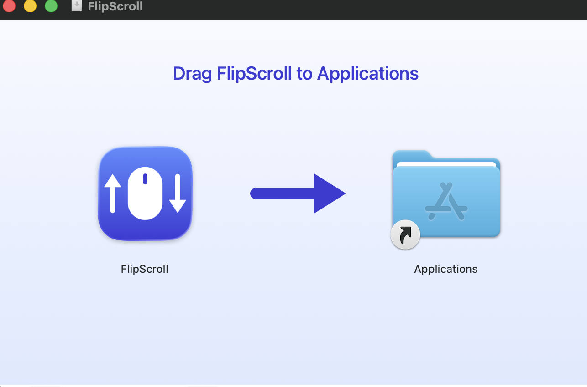
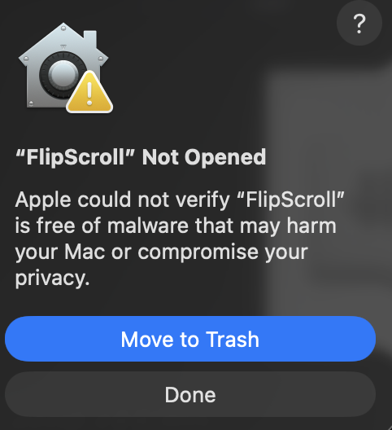
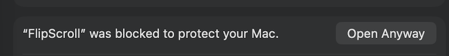

# FlipScroll

A small macOS menu bar app that lets the mouse and the trackpad scroll in different directions.

Keep "Natural scrolling" on in System Settings, and FlipScroll reverses only the mouse wheel.

Requires macOS 13 or later, on an Apple Silicon or Intel Mac. Tested on macOS 26.

## Install

### 1. Download and install

Download the latest `.dmg` file from [Releases](https://github.com/emirhandagasan/FlipScroll/releases/latest). Open it and drag **FlipScroll** onto **Applications**.



### 2. Open FlipScroll

Open FlipScroll from your Applications folder. The first time, macOS shows this warning because FlipScroll is not verified by Apple. Click **Done**, not **Move to Trash**.



### 3. Allow it to open

Go to **System Settings → Privacy & Security**, scroll down to **Security**, and click **Open Anyway**. Confirm with your password or Touch ID. You only need to do this once.



## Permission

FlipScroll needs Accessibility access to change scroll events. On first launch, allow it in **System Settings → Privacy & Security → Accessibility**.

If it stops working after an update, remove FlipScroll from that list with **–** and allow it again.

## Menu

- **Enabled**: turns all reversing on or off
- **Reverse Mouse**: reverses the mouse wheel
- **Reverse Trackpad**: reverses the trackpad
- **Speed Keys** (off by default): hold ⌥ to scroll the mouse 4x faster, or ⌃ to scroll it 4x slower
- **Launch at Login**: starts FlipScroll when you log in

## Known limitations

Magic Mouse and some free-spinning wheels send smooth scroll events, so FlipScroll may treat them as a trackpad.

## Build from source

Requires Swift 5.9 or later. If you don't have it, install the Command Line Tools:

```bash
xcode-select --install
```

Then build and install:

```bash
git clone https://github.com/emirhandagasan/FlipScroll.git
cd FlipScroll
./scripts/install.sh
```

This builds the app, copies it to `/Applications` and opens it.

Other scripts:

- `./scripts/build-app.sh`: builds `build/FlipScroll.app` only
- `./scripts/make-dmg.sh`: builds a DMG into `build/`

## Uninstall

Quit FlipScroll from its menu and move `/Applications/FlipScroll.app` to the Trash.
